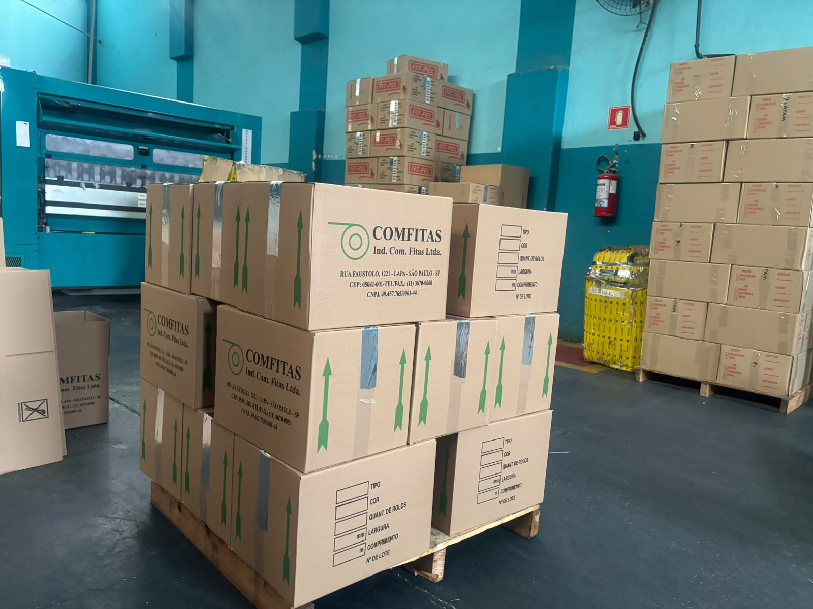

# Fitpel Site — Entrega 2

Site institucional da FIT-PEL, desenvolvido para a disciplina de Desenvolvimento Frontend para Web — A2 (2026.2).
A Entrega 1 construiu a estrutura em HTML5 semântico; a Entrega 2 acrescenta CSS (identidade visual) e JavaScript (interatividade).

**Professor:** Cid Andrade

> **Como usar este rascunho:** tudo o que está como `[PREENCHER]` ou `[CONFIRMAR]` precisa ser feito ou conferido pelo grupo antes da entrega. O que já está escrito vem do README da Entrega 1 ou descreve o que realmente está no código.

## Alunos

- Guilherme Souza Do Carmo — RGM: 47856424
- Matheus Victoriano Pires Barbosa — RGM: 47387980
- Diogo de Castro Moreira — RGM: 47629045

## Site hospedado

[https://tyiwe.github.io/projeto-fitpel-frontend/](https://tyiwe.github.io/projeto-fitpel-frontend/)

## Introdução

A FIT-PEL é uma fabricante brasileira de fitas adesivas, com sede própria na Mooca, São Paulo, atuando no mercado há mais de 37 anos. A empresa produz uma linha completa de fitas — de embalagem, dupla face, técnicas e personalizadas — atendendo indústrias, distribuidores e e-commerces em todo o Brasil, com uma estrutura fabril de 8.000 m² e mais de 120 colaboradores.

O objetivo deste site é apresentar a empresa, seus produtos e diferenciais de forma clara e organizada, funcionando como um canal de contato e solicitação de orçamento para clientes em potencial, além de esclarecer dúvidas frequentes sobre qual tipo de fita utilizar em cada aplicação.

## Desenvolvimento

### Levantamento com a organização

O contato com a FIT-PEL foi feito de forma presencial, através de visita à fábrica, localizada na Mooca, São Paulo. Na ocasião, o membro Guilherme conversou com o gerente da empresa, que apresentou brevemente a estrutura fabril e o processo produtivo, e autorizou o uso de fotos, vídeo institucional e do logotipo da empresa neste projeto acadêmico.

**Comprovação do contato:**



*Foto tirada durante a visita à fábrica, mostrando caixas de fita adesiva e maquinário de produção.*

### Estrutura do site

O site tem 10 páginas HTML interligadas por um menu de navegação consistente:

- `index.html` — página inicial, com apresentação da empresa e destaques dos produtos
- `paginas/contato.html` — formulário de contato
- `paginas/orcamento.html` — solicitação de orçamento
- `paginas/quem-somos.html` — história e identidade da empresa (com áudio)
- `paginas/fabrica.html` — estrutura fabril, com vídeo institucional
- `paginas/produtos.html` — linha de produtos, com busca instantânea
- `paginas/aplicacoes.html` — segmentos atendidos
- `paginas/fita-personalizada.html` — fita personalizada com logotipo do cliente (com vídeo)
- `paginas/qual-fita-usar.html` — guia de escolha de produto, com busca na tabela
- `paginas/faq.html` — perguntas frequentes

```
projeto-fitpel-frontend/
├── README.md
├── LICENSE
├── index.html
├── paginas/
│   ├── contato.html
│   ├── orcamento.html
│   ├── quem-somos.html
│   ├── fabrica.html
│   ├── produtos.html
│   ├── aplicacoes.html
│   ├── fita-personalizada.html
│   ├── qual-fita-usar.html
│   └── faq.html
├── css/
│   └── style.css
├── js/
│   └── main.js
└── assets/
    ├── img/        (fotos, logo, rolo-fita.svg, favicon.svg)
    ├── audio/
    └── video/
```

### Decisões técnicas

**HTML (Entrega 1)**

- Marcação semântica HTML5 (`header`, `nav`, `main`, `section`, `article`, `footer`) em todas as páginas.
- Formulários de contato e de orçamento com validação nativa do HTML5 (`required`, `pattern`, `type="email"`, `type="tel"`, `minlength`, `min`), sem depender de JavaScript para a validação básica.
- `<audio>` (Quem Somos) e `<video>` (Nossa Fábrica e Fita Personalizada) incorporados.

**CSS (Entrega 2)**

- Um único arquivo, `css/style.css`, organizado em seções: tokens (variáveis de cor e fonte), base, estrutura, componentes, páginas específicas e responsivo.
- Identidade visual unificada a partir do logotipo: vermelho `#DC251A` e preto da marca, cinza claro de fundo e um tom de papel kraft usado como acento (marrom das fitas).
- Tipografia: **Barlow Condensed** nos títulos (referência a sinalização e etiquetas industriais) e **Barlow** no texto corrido.
- Componentes consistentes em todas as páginas: botões, cards, tabelas, formulários, perguntas frequentes (`<details>`) e faixa de chamada para ação.
- **Grid Layout** na estrutura da página (miolo centralizado com o hero ocupando a largura toda), na grade de cards, nos números do hero, nos campos dos formulários e no rodapé. **Flexbox** no cabeçalho, no menu, nos grupos de botões e nos cards de segmentos.
- Layout responsivo (desktop, tablet e celular), com foco visível no teclado, link "Pular para o conteúdo" e respeito à preferência de movimento reduzido.

**SVG**

- `assets/img/rolo-fita.svg`: ilustração do rolo de fita vermelha com a ponta solta estampada "FIT-PEL", usada no hero da página inicial. Também há um `favicon.svg`.

**JavaScript (Entrega 2)** — arquivo `js/main.js`, em JavaScript puro e como melhoria progressiva (sem JS, o site continua funcionando):

- Menu responsivo com botão "Menu" no celular (abre/fecha com clique e fecha com `Esc`).
- Busca instantânea em **Produtos** e na tabela de **Qual fita usar**, com contagem de resultados.
- **Perguntas frequentes**: botões "Expandir todas" e "Recolher todas".
- **Formulários**: máscara de telefone `(11) 91234-5678`, mensagens de erro em português ao sair do campo, confirmação de envio e data mínima (hoje) no prazo do orçamento.
- Números da página inicial que "contam" até o valor final e botão "Topo".

> **Sobre o envio dos formulários:** por enquanto o formulário roda em **modo demonstração** (`action="#"`): ele valida, mostra a confirmação e avisa que nenhum dado foi enviado. Para um envio real, basta trocar o `action` por um endpoint de serviço de formulários (ex.: Formspree) — o `main.js` já envia via `fetch` quando o `action` é diferente de `#`. `[CONFIRMAR]` qual opção o grupo adotou.

### Pesquisa de leiaute e aparência de outros sites da área

`[PREENCHER]` — o enunciado pede pesquisa de sites da mesma área. Sugestão de formato (3 a 5 sites de fabricantes ou distribuidores de fitas adesivas):

| Site pesquisado | Link | O que observamos (menu, cores, cards, formulário) | O que aproveitamos / o que evitamos |
|---|---|---|---|
| `[PREENCHER]` | | | |
| `[PREENCHER]` | | | |
| `[PREENCHER]` | | | |

### Testes de paleta de cores, tipografia e outros elementos

`[PREENCHER]` — descrever os testes **realmente feitos** pelo grupo (prints das alternativas testadas, o que foi descartado e por quê). Sugestão de formato:

| Elemento | Alternativas testadas | Escolha final | Motivo |
|---|---|---|---|
| Paleta | `[PREENCHER]` | Vermelho `#DC251A`, preto, cinza claro e kraft | Vem do logotipo da FIT-PEL; `[PREENCHER: o que foi testado e descartado]` |
| Fonte dos títulos | `[PREENCHER]` | Barlow Condensed | `[PREENCHER]` |
| Fonte do texto | `[PREENCHER]` | Barlow | `[PREENCHER]` |
| Cards / botões / tabelas | `[PREENCHER]` | Ver `css/style.css` | `[PREENCHER]` |

### Desafios técnicos

Da Entrega 1:

- **Validação nativa do formulário (`required`, `pattern`, `type="email"`):** o `required` sozinho não garante o formato certo do dado — foi preciso pesquisar como o `pattern` funciona com expressões regulares (por exemplo, para aceitar o telefone no formato `(11) 91234-5678`) e entender por que `type="email"` já valida a estrutura de um e-mail.
- **Caminhos relativos:** os arquivos dentro de `paginas/` referenciavam `assets/` como se estivessem na raiz, gerando erro 404. Foi necessário usar `../` para subir um nível de pasta.
- **Vídeo institucional:** o vídeo fornecido pela empresa precisou ser recodificado com o HandBrake (codec H.264) para garantir compatibilidade nos navegadores.
- **Proporção de imagens:** a imagem de capa (poster) do vídeo estava em formato retrato e distorcia o `<video>`; foi cortada para widescreen.
- **Padronização de indentação** entre os integrantes do grupo.

Da Entrega 2:

- **Caminhos absolutos no GitHub Pages:** o site fica em `/projeto-fitpel-frontend/`, então caminhos começando com `/assets/...` (usados no `poster` e no vídeo da página Fita Personalizada) quebram na hospedagem. Todos foram trocados por caminhos relativos (`../assets/...`).
- **Aplicar identidade visual sem mexer na semântica:** foi preciso adicionar poucas classes ao HTML (por exemplo `.cards`, `.hero`, `.chamada`) e agrupar os `<article>` em contêineres para montar as grades, mantendo a estrutura semântica da Entrega 1.
- **JavaScript como melhoria, não como dependência:** o menu só se esconde no celular se o JavaScript carregar; a validação continua sendo a nativa do HTML5.
- `[PREENCHER]` outros desafios que o grupo encontrou.

### Como seria o mesmo resultado desenvolvido com IA

`[REVISAR/AJUSTAR]` — rascunho:

Se o site fosse desenvolvido do zero com IA, o processo equivalente seria: (1) levantar com a empresa os conteúdos reais (serviços, diferenciais, contatos), pois a IA não substitui a entrevista; (2) fornecer à IA o conteúdo, o logotipo, o enunciado com os requisitos e referências de sites da área; (3) pedir a estrutura HTML semântica das 10 páginas e, em seguida, o CSS com a paleta extraída do logotipo e a lista de componentes; (4) pedir o JavaScript para cada comportamento desejado, um de cada vez; (5) revisar o código gerado, testar em navegador e em celular, validar no W3C Validator e no CSS Validation Service e corrigir o que falhar; (6) versionar no GitHub em commits pequenos. O ganho está na velocidade de produzir e iterar o código; o que continua dependendo do grupo é o conteúdo verdadeiro, as decisões de design, a verificação e o entendimento do que foi entregue.

## Uso de Inteligência Artificial

Na Entrega 1, a IA (Claude) foi usada como apoio ao aprendizado e à execução: dúvidas sobre tags e atributos HTML, formatação, convenções de nomes de arquivos, uso do Git e GitHub e resolução de problemas pontuais (caminhos relativos e compatibilidade de vídeo). O conteúdo textual foi escrito e levantado pelo grupo (incluindo informações do site oficial da empresa e da conversa com o responsável) e organizado com auxílio de IA.

Na Entrega 2:

- **Modelo utilizado:** Claude (Anthropic) — `[CONFIRMAR o modelo/versão exata usada]`.
- **Motivação:** o grupo ainda está aprendendo CSS e JavaScript e quis acelerar a construção da identidade visual e dos componentes interativos, mantendo o HTML da Entrega 1 como base.
- **O que foi pedido à IA:** o CSS de todas as páginas, o JavaScript dos componentes (menu, busca, FAQ, formulários), a ilustração SVG do rolo de fita e pequenos ajustes no HTML (links para CSS/JS, classes, caminhos relativos).
- **Verificação das respostas:** `[CONFIRMAR e AJUSTAR conforme o que o grupo fez de fato]` — leitura e teste do código no navegador (desktop e celular), teste dos formulários (campos vazios, e-mail inválido, telefone), teste dos menus, busca e FAQ, validação das páginas no W3C Validator e do CSS no CSS Validation Service, e comparação do resultado com o enunciado.
- **Decisões do grupo:** `[PREENCHER]` o que o grupo escolheu, alterou ou recusou em relação ao que a IA sugeriu.

## Validação (W3C)

`[PREENCHER]` — rodar **todas as páginas** em https://validator.w3.org/ e o CSS em https://jigsaw.w3.org/css-validator/ e anexar os prints ao repositório (ex.: `assets/img/validacao/`).

| Página | Resultado no W3C Validator | Print |
|---|---|---|
| index.html | `[PREENCHER]` | `[PREENCHER]` |
| paginas/contato.html | `[PREENCHER]` | `[PREENCHER]` |
| paginas/orcamento.html | `[PREENCHER]` | `[PREENCHER]` |
| paginas/quem-somos.html | `[PREENCHER]` | `[PREENCHER]` |
| paginas/fabrica.html | `[PREENCHER]` | `[PREENCHER]` |
| paginas/produtos.html | `[PREENCHER]` | `[PREENCHER]` |
| paginas/aplicacoes.html | `[PREENCHER]` | `[PREENCHER]` |
| paginas/fita-personalizada.html | `[PREENCHER]` | `[PREENCHER]` |
| paginas/qual-fita-usar.html | `[PREENCHER]` | `[PREENCHER]` |
| paginas/faq.html | `[PREENCHER]` | `[PREENCHER]` |
| css/style.css (CSS Validation Service) | `[PREENCHER]` | `[PREENCHER]` |

## Domínio

`[PREENCHER]` — o enunciado pede que o grupo explicite qual domínio compraria e o processo de aquisição, com a pesquisa de disponibilidade comprovada, caso a empresa ainda não tenha um.

- **Situação atual:** a FIT-PEL já usa o e-mail `sac@fitpel.com.br`, o que indica que a empresa provavelmente já possui o domínio `fitpel.com.br`. `[CONFIRMAR]` consultando o domínio em https://registro.br e anexar o print da consulta (titular e situação do domínio).
- **Se a empresa não tivesse domínio:** `[PREENCHER]` domínio escolhido (ex.: `fitpel.com.br`), consulta de disponibilidade no Registro.br (print), processo de compra (cadastro, pagamento anual, apontamento de DNS para o GitHub Pages ou Netlify) e custo estimado.

## Conclusão

`[PREENCHER]` — reflexão do grupo sobre o resultado e os aprendizados da etapa. Sugestões de pontos para comentar:

- O que mudou no site ao passar do HTML puro para o CSS (organização visual, identidade da marca).
- O que foi mais difícil: Grid e Flexbox, responsividade, JavaScript, validação.
- O que aprenderam sobre melhoria progressiva (o site funciona sem JavaScript?) e sobre acessibilidade.
- O que aprenderam trabalhando com IA, o que precisou ser verificado ou corrigido, e o que faria diferente.
- O que fariam como próximos passos (envio real do formulário, otimização de imagens e vídeos, domínio próprio).

## Como visualizar

Abra o arquivo `index.html` em um navegador, ou acesse o link do site hospedado acima.
