# Fitpel Site — Entrega 2

Site institucional da FIT-PEL, desenvolvido para a disciplina de Desenvolvimento Frontend para Web — A2 (2026.2).
A Entrega 1 construiu a estrutura em HTML5 semântico; a Entrega 2 acrescenta CSS (identidade visual) e JavaScript (interatividade).

**Professor:** Cid Andrade


## Alunos

- Guilherme Souza Do Carmo — RGM: 47856424
- Matheus Victoriano Pires Barbosa — RGM: 47387980
- Diogo de Castro Moreira — RGM: 47629045

## Site hospedado

[https://tyiwe.github.io/projeto-fitpel-frontend/](https://tyiwe.github.io/projeto-fitpel-frontend/)

## Introdução

A FIT-PEL é uma fabricante brasileira de fitas adesivas, com sede própria na Mooca, São Paulo, atuando no mercado há mais de 37 anos. A empresa produz uma linha completa de fitas — de embalagem, dupla face, técnicas e personalizadas — atendendo indústrias, distribuidores e e-commerces em todo o Brasil, com uma estrutura fabril de 8.000 m² e mais de 120 colaboradores.

O objetivo deste site é apresentar a empresa, seus produtos e diferenciais de forma clara e organizada, funcionando como um canal de contato e solicitação de orçamento para clientes em potencial, além de esclarecer dúvidas frequentes sobre qual tipo de fita utilizar em cada aplicação.

## Desenvolvimento

### Levantamento com a organização

O contato com a FIT-PEL foi feito de forma presencial, através de visita à fábrica, localizada na Mooca, São Paulo. Na ocasião, o membro Guilherme conversou com o gerente da empresa, que apresentou brevemente a estrutura fabril e o processo produtivo, e autorizou o uso de fotos, vídeo institucional e do logotipo da empresa neste projeto acadêmico.

**Comprovação do contato:**

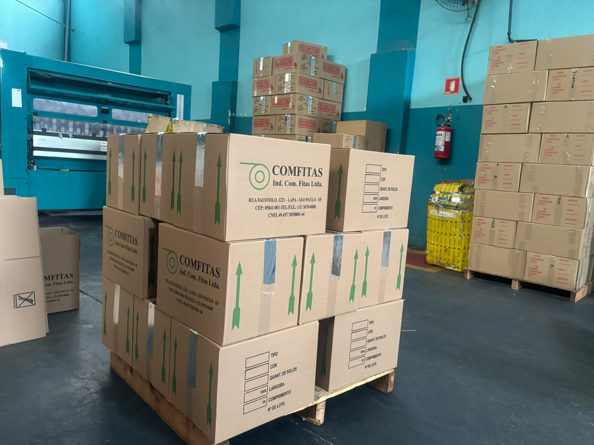

*Foto tirada durante a visita à fábrica, mostrando caixas de fita adesiva e maquinário de produção.*

### Estrutura do site

O site tem 10 páginas HTML interligadas por um menu de navegação consistente:

- `index.html` — página inicial, com apresentação da empresa e destaques dos produtos
- `paginas/contato.html` — formulário de contato
- `paginas/orcamento.html` — solicitação de orçamento
- `paginas/quem-somos.html` — história e identidade da empresa (com áudio)
- `paginas/fabrica.html` — estrutura fabril, com vídeo institucional
- `paginas/produtos.html` — linha de produtos, com busca instantânea
- `paginas/aplicacoes.html` — segmentos atendidos
- `paginas/fita-personalizada.html` — fita personalizada com logotipo do cliente (com vídeo)
- `paginas/qual-fita-usar.html` — guia de escolha de produto, com busca na tabela
- `paginas/faq.html` — perguntas frequentes

```
projeto-fitpel-frontend/
├── README.md
├── LICENSE
├── index.html
├── paginas/
│   ├── contato.html
│   ├── orcamento.html
│   ├── quem-somos.html
│   ├── fabrica.html
│   ├── produtos.html
│   ├── aplicacoes.html
│   ├── fita-personalizada.html
│   ├── qual-fita-usar.html
│   └── faq.html
├── css/
│   └── style.css
├── js/
│   └── main.js
└── assets/
    ├── img/        (fotos, logo, rolo-fita.svg, favicon.svg)
    ├── audio/
    └── video/
```

### Decisões técnicas

**HTML (Entrega 1)**

- Marcação semântica HTML5 (`header`, `nav`, `main`, `section`, `article`, `footer`) em todas as páginas.
- Formulários de contato e de orçamento com validação nativa do HTML5 (`required`, `pattern`, `type="email"`, `type="tel"`, `minlength`, `min`), sem depender de JavaScript para a validação básica.
- `<audio>` (Quem Somos) e `<video>` (Nossa Fábrica e Fita Personalizada) incorporados.

**CSS (Entrega 2)**

- Um único arquivo, `css/style.css`, organizado em seções: tokens (variáveis de cor e fonte), base, estrutura, componentes, páginas específicas e responsivo.
- Identidade visual unificada a partir do logotipo, com a paleta **Industrial & Logística**: vermelho `#DC251A` (o mesmo vermelho do logo) no menu, nos botões e nos destaques; grafite `#2C302E` nos textos, títulos, hero e rodapé; cinza claro `#F2F4F7` nos cards, formulários e perguntas frequentes; branco `#FFFFFF` no fundo das páginas; e kraft `#D7A15C` / `#C48B47` como acento (cor de caixa de papelão e de fita crepe). O contraste entre texto e fundo foi calculado e todos os pares usados passam de 4,5:1 (os textos principais passam de 12:1).
- Tipografia: **Oswald** (pesos 600 e 700) nos títulos e no menu, por ser condensada e lembrar fita de marcação e embalagem industrial, e **Inter** (pesos 400 e 600) no texto corrido, por ser desenhada para telas e ler bem em tabelas e descrições técnicas. As duas são carregadas pelo Google Fonts.
- Componentes consistentes em todas as páginas: botões, cards, tabelas, formulários, perguntas frequentes (`<details>`) e faixa de chamada para ação.
- **Grid Layout** na estrutura da página (miolo centralizado com o hero ocupando a largura toda), na grade de cards, nos números do hero, nos campos dos formulários e no rodapé. **Flexbox** no cabeçalho, no menu, nos grupos de botões e nos cards de segmentos.
- Layout responsivo (desktop, tablet e celular), com foco visível no teclado, link "Pular para o conteúdo" e respeito à preferência de movimento reduzido.

**SVG**

- `assets/img/rolo-fita.svg`: ilustração do rolo de fita vermelha com a ponta solta estampada "FIT-PEL", usada no hero da página inicial. Também há um `favicon.svg`.

**JavaScript (Entrega 2)** — arquivo `js/main.js`, em JavaScript puro e como melhoria progressiva (sem JS, o site continua funcionando):

- Menu responsivo com botão "Menu" no celular (abre/fecha com clique e fecha com `Esc`).
- Busca instantânea em **Produtos** e na tabela de **Qual fita usar**, com contagem de resultados.
- **Perguntas frequentes**: botões "Expandir todas" e "Recolher todas".
- **Formulários**: máscara de telefone `(11) 91234-5678`, mensagens de erro em português ao sair do campo, confirmação de envio e data mínima (hoje) no prazo do orçamento.
- Números da página inicial que "contam" até o valor final e botão "Topo".

> **Envio dos formulários:** os formulários de contato e de orçamento enviam os dados de verdade pelo **Formspree** (serviço gratuito de formulários, já que o GitHub Pages só hospeda arquivos estáticos). A validação nativa do HTML5 roda primeiro; se estiver tudo certo, o `main.js` envia os dados por `fetch` ao endpoint do Formspree, sem recarregar a página, e mostra a confirmação (ou uma mensagem de erro, se o envio falhar). As mensagens chegam ao e-mail de um integrante do grupo, e não ao da empresa, por se tratar de um trabalho acadêmico.

### Pesquisa de leiaute e aparência de outros sites da área

Antes de definir o visual, o grupo visitou sites de fabricantes de fitas adesivas e outros produtos industriais para ver como organizam menu, produtos e contato. Os prints das páginas iniciais estão em `assets/img/pesquisa/`.

| Site pesquisado | O que observamos | O que aproveitamos / o que evitamos |
|---|---|---|
| [3M Brasil](https://www.3m.com.br/3M/pt_BR/3m-do-brasil/) | Fundo branco, logo e botões em vermelho, tipografia sem serifa e limpa. Barra de busca grande no topo e menu enxuto, com apenas 3 itens (Produtos, Indústrias e Marcas). Imagem grande com caixa escura e título, botão vermelho "Saiba mais" e quatro blocos escuros com ícone e link logo abaixo. Produtos em lista de categorias, sem formulário de contato na página. Print: `assets/img/pesquisa/pesquisa-3m.png` | Aproveitamos o vermelho como cor de destaque nos botões sobre fundo neutro e a entrada por segmento (nossa página Aplicações). Evitamos um menu tão reduzido, porque esconde conteúdo, e colocamos o orçamento direto no menu |
| [tesa Brasil](https://www.tesa.com/pt-br) | Faixa azul no topo com as abas Indústria e Profissionais, cabeçalho branco com texto azul escuro e logo azul e vermelho. Imagem grande em carrossel (com setas e pausa), caixa azul com título e botão vermelho "SAIBA MAIS". Menus suspensos grandes, com mercados, aplicações e produtos. Print: `assets/img/pesquisa/pesquisa-tesa.png` | Aproveitamos o botão vermelho de chamada para ação em destaque e a organização por aplicação. Evitamos o azul, que não existe na marca da FIT-PEL, e os menus com dezenas de itens: o nosso é único e direto, e o guia "Qual fita usar" ajuda a escolher o produto |
| [Adelbras](https://www.adelbras.com/) | Fundo claro, vermelho como cor principal (logo, títulos, botões) e fonte arredondada. Menu horizontal pequeno (Home, Quem Somos, Produtos, Blog, Contato), links secundários (Representantes, Downloads, Boletos), busca, botão vermelho "Entrar" e escolha de idioma. Imagem grande em carrossel com o produto em lançamento e botão "Conheça essa novidade"; faixa de cookies cobrindo parte da tela. Print: `assets/img/pesquisa/pesquisa-adelbras.png` | Aproveitamos o produto em destaque ao lado de um título e um botão. Evitamos o carrossel como conteúdo principal, porque esconde informação atrás de cliques e setas; preferimos um hero fixo com os números da empresa e botões de ação visíveis |

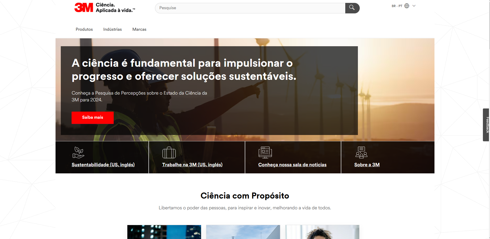
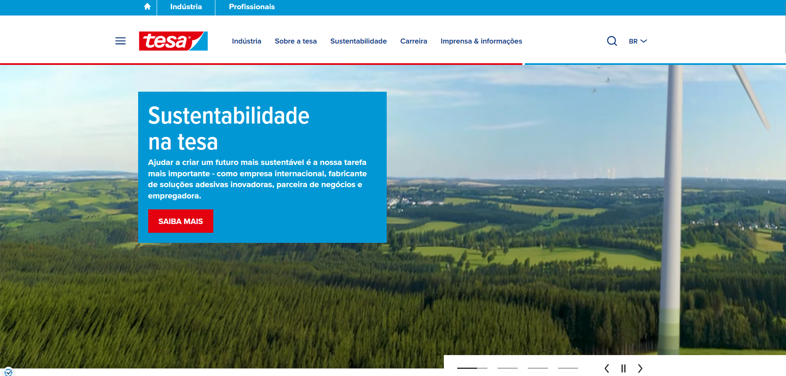
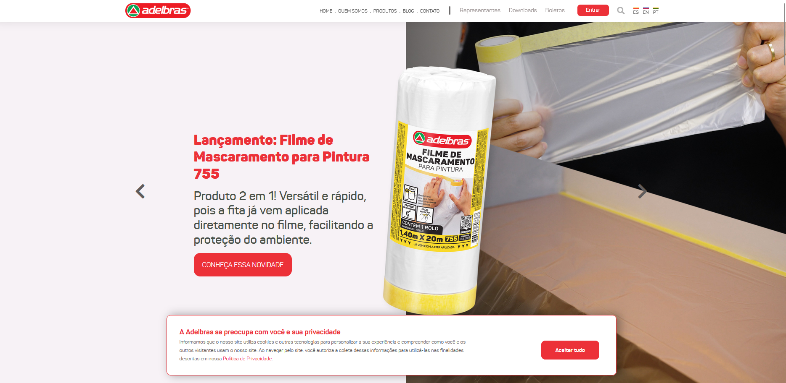

### Testes de paleta de cores, tipografia e outros elementos

A identidade visual passou por duas rodadas. Na primeira versão, o site foi montado com preto, o vermelho do logo e as fontes Barlow Condensed e Barlow. Na segunda, o grupo pediu ao Gemini sugestões de fontes e paletas para o setor de fitas adesivas, comparou as opções e aplicou a escolhida no código. **Fontes comparadas** (combinação título + texto):

| Estilo de marca | Fonte dos títulos | Fonte do corpo | Sensação transmitida |
|---|---|---|---|
| **Industrial / B2B** (escolhida) | Oswald (Bold) | Inter (Regular) | Robustez, força técnica e eficiência operacional |
| E-commerce / embalagens | Montserrat (SemiBold) | Roboto (Regular) | Profissionalismo, agilidade e segurança na entrega |
| Papelaria / decorativa | Outfit (Bold) | Plus Jakarta Sans | Modernidade, criatividade e acabamento limpo |

**Paletas comparadas:**

| Paleta | Cores | Observação |
|---|---|---|
| **1. Industrial & Logística** (escolhida) | Vermelho, kraft `#D7A15C` / `#C48B47`, grafite `#2C302E`, cinza claro `#F2F4F7`, branco | Kraft e grafite remetem a embalagem, expedição e ao setor B2B |
| 2. Corporativa Tech & Confiança | Vermelho `#DC2626`, azul marinho `#1E293B`, cinza azulado `#E2E8F0`, grafite `#0F172A`, branco | Azul passa credibilidade, mas não aparece na marca |
| 3. Alta Performance & Resistência | Vermelho `#CC0000`, preto asfalto `#18181B`, amarelo `#F59E0B`, cinza `#F4F4F5`, branco | Visual de ferramentas pesadas; o amarelo competiria com o vermelho |

**Resultado dos testes:**

| Elemento | Escolha final | Motivo |
|---|---|---|
| Paleta | Paleta 1, mantendo o vermelho exato do logo (`#DC251A`) no lugar do `#D32F2F` sugerido | O kraft liga o site ao produto e o vermelho igual ao do logo evita dois vermelhos diferentes lado a lado |
| Fonte dos títulos | Oswald (600 e 700) | Condensada e estruturada, lembra fita de marcação e caixas |
| Fonte do texto | Inter (400 e 600) | Feita para telas; boa leitura em tabelas de medidas e descrições |
| Cards, botões e tabelas | Cards em cinza claro com barra vermelha no topo; botões vermelhos que escurecem no hover; tabela com cabeçalho grafite e linhas alternadas | Mesmo padrão em todas as páginas, definido em `css/style.css` |
| Contraste | Texto grafite sobre branco 13,4:1; branco sobre vermelho 4,9:1; link vermelho escuro sobre branco 7,6:1 | Leitura confortável, acima do mínimo de 4,5:1 |

### Desafios técnicos

Da Entrega 1:

- **Validação nativa do formulário (`required`, `pattern`, `type="email"`):** o `required` sozinho não garante o formato certo do dado — foi preciso pesquisar como o `pattern` funciona com expressões regulares (por exemplo, para aceitar o telefone no formato `(11) 91234-5678`) e entender por que `type="email"` já valida a estrutura de um e-mail.
- **Caminhos relativos:** os arquivos dentro de `paginas/` referenciavam `assets/` como se estivessem na raiz, gerando erro 404. Foi necessário usar `../` para subir um nível de pasta.
- **Vídeo institucional:** o vídeo fornecido pela empresa precisou ser recodificado com o HandBrake (codec H.264) para garantir compatibilidade nos navegadores.
- **Proporção de imagens:** a imagem de capa (poster) do vídeo estava em formato retrato e distorcia o `<video>`; foi cortada para widescreen.
- **Padronização de indentação** entre os integrantes do grupo.

Da Entrega 2:

- **Caminhos absolutos no GitHub Pages:** o site fica em `/projeto-fitpel-frontend/`, então caminhos começando com `/assets/...` (usados no `poster` e no vídeo da página Fita Personalizada) quebram na hospedagem. Todos foram trocados por caminhos relativos (`../assets/...`).
- **Aplicar identidade visual sem mexer na semântica:** foi preciso adicionar poucas classes ao HTML (por exemplo `.cards`, `.hero`, `.chamada`) e agrupar os `<article>` em contêineres para montar as grades, mantendo a estrutura semântica da Entrega 1.
- **Trocar de fonte exige reajustar o layout:** ao passar de Barlow Condensed e Barlow para Oswald e Inter (mais largas), o menu de 10 itens quebrava em duas linhas em telas de notebook. Foi preciso reduzir o tamanho da fonte do menu e fazer o menu virar botão a partir de 1280 px de largura.
- **JavaScript como melhoria, não como dependência:** o menu só se esconde no celular se o JavaScript carregar; a validação continua sendo a nativa do HTML5.

### Como seria o mesmo resultado desenvolvido com IA

Se o site fosse desenvolvido do zero com IA, o processo equivalente seria: (1) levantar com a empresa os conteúdos reais (serviços, diferenciais, contatos), pois a IA não substitui a entrevista; (2) fornecer à IA o conteúdo, o logotipo, o enunciado com os requisitos e referências de sites da área; (3) pedir a estrutura HTML semântica das 10 páginas e, em seguida, o CSS com a paleta extraída do logotipo e a lista de componentes; (4) pedir o JavaScript para cada comportamento desejado, um de cada vez; (5) revisar o código gerado, testar em navegador e em celular, validar no W3C Validator e no CSS Validation Service e corrigir o que falhar; (6) versionar no GitHub em commits pequenos. O ganho está na velocidade de produzir e iterar o código; o que continua dependendo do grupo é o conteúdo verdadeiro, as decisões de design, a verificação e o entendimento do que foi entregue.

## Uso de Inteligência Artificial

Na Entrega 1, a IA (Claude) foi usada como apoio ao aprendizado e à execução: dúvidas sobre tags e atributos HTML, formatação, convenções de nomes de arquivos, uso do Git e GitHub e resolução de problemas pontuais (caminhos relativos e compatibilidade de vídeo). O conteúdo textual foi escrito e levantado pelo grupo (incluindo informações do site oficial da empresa e da conversa com o responsável) e organizado com auxílio de IA.

Na Entrega 2:

- **Modelos utilizados:** Claude (Anthropic) para escrever e ajustar o CSS, o JavaScript e o HTML, e Gemini (Google) para sugerir combinações de fontes e paletas de cores do setor de fitas adesivas.
- **Motivação:** o grupo ainda está aprendendo CSS e JavaScript e quis acelerar a construção da identidade visual e dos componentes interativos, mantendo o HTML da Entrega 1 como base.
- **O que foi pedido à IA:** o CSS de todas as páginas, o JavaScript dos componentes (menu, busca, FAQ, formulários), a ilustração SVG do rolo de fita, pequenos ajustes no HTML (links para CSS/JS, classes, caminhos relativos) e, depois, a troca das fontes e da paleta pelas opções escolhidas pelo grupo.
- **Verificação das respostas:** o código gerado não foi usado de uma vez: o grupo pegou o que a IA sugeriu em pequenas partes e modificou por conta própria. Cada mudança foi testada no navegador com o Live Server, as páginas foram validadas no W3C Validator e o CSS no CSS Validation Service, e o resultado foi comparado com o enunciado da entrega.
- **Decisões do grupo:** entre as três paletas e as três combinações de fontes sugeridas, o grupo escolheu a paleta Industrial & Logística e a combinação Oswald + Inter, e manteve o vermelho exato do logo em vez do tom sugerido. O grupo também ajustou o código sugerido pela IA ao conteúdo real da empresa e corrigiu problemas que apareceram nos testes, como o menu de 10 itens que quebrava em duas linhas.

## Validação (W3C)

Todas as páginas foram validadas no [W3C Markup Validator](https://validator.w3.org/) e o CSS no [CSS Validation Service](https://jigsaw.w3.org/css-validator/). Os prints de cada resultado estão em `assets/img/validacao/`.

| Página | Validador | Print |
|---|---|---|
| index.html | W3C Markup Validator | [index-validado.png](assets/img/validacao/index-validado.png) |
| paginas/contato.html | W3C Markup Validator | [contato-validado.png](assets/img/validacao/contato-validado.png) |
| paginas/orcamento.html | W3C Markup Validator | [orcamento-validado.png](assets/img/validacao/orcamento-validado.png) |
| paginas/quem-somos.html | W3C Markup Validator | [quem-somos-validado.png](assets/img/validacao/quem-somos-validado.png) |
| paginas/fabrica.html | W3C Markup Validator | [fabrica-validado.png](assets/img/validacao/fabrica-validado.png) |
| paginas/produtos.html | W3C Markup Validator | [produtos-validado.png](assets/img/validacao/produtos-validado.png) |
| paginas/aplicacoes.html | W3C Markup Validator | [aplicacoes-validado.png](assets/img/validacao/aplicacoes-validado.png) |
| paginas/fita-personalizada.html | W3C Markup Validator | [fita-personalizada-validado.png](assets/img/validacao/fita-personalizada-validado.png) |
| paginas/qual-fita-usar.html | W3C Markup Validator | [qual-fita-usar-validado.png](assets/img/validacao/qual-fita-usar-validado.png) |
| paginas/faq.html | W3C Markup Validator | [faq-validado.png](assets/img/validacao/faq-validado.png) |
| css/style.css | CSS Validation Service | [css-validado.png](assets/img/validacao/css-validado.png) |

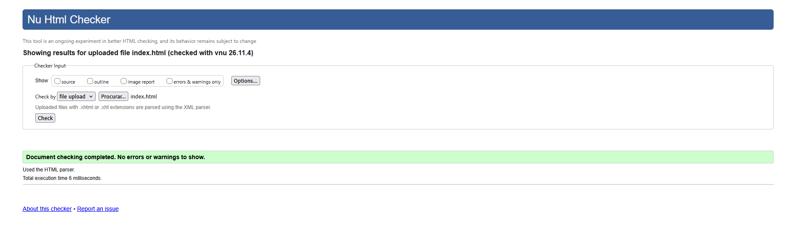
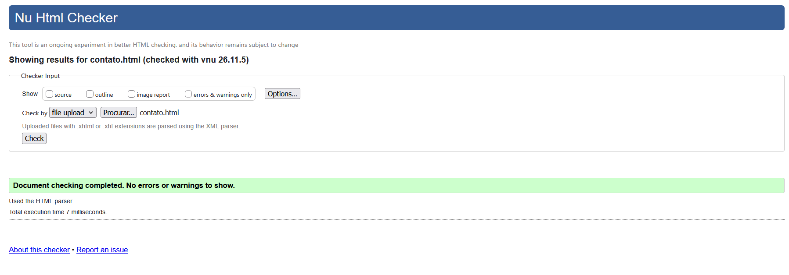
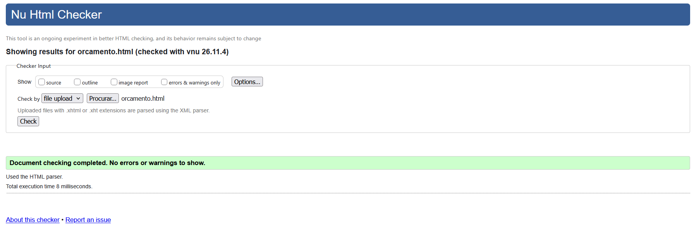
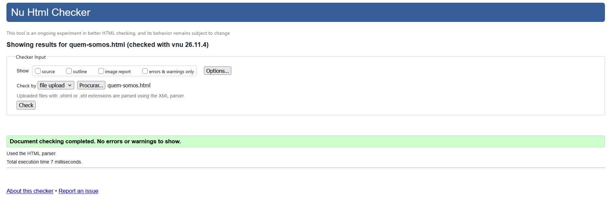
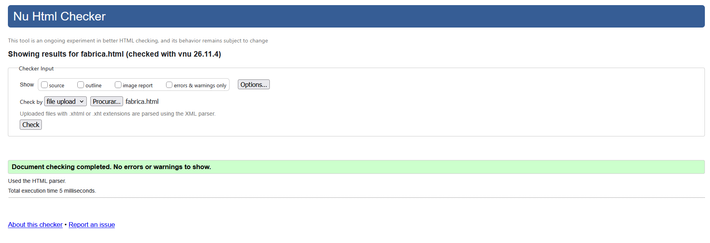
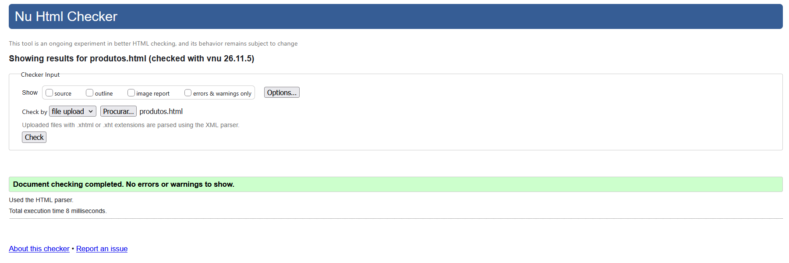
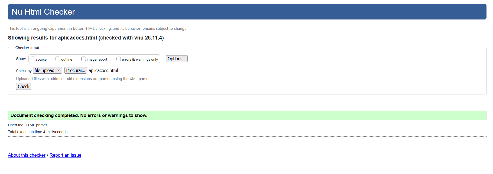
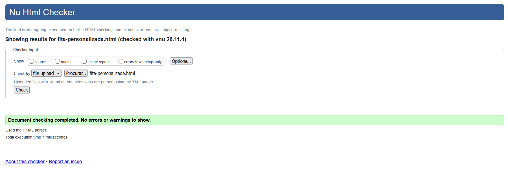
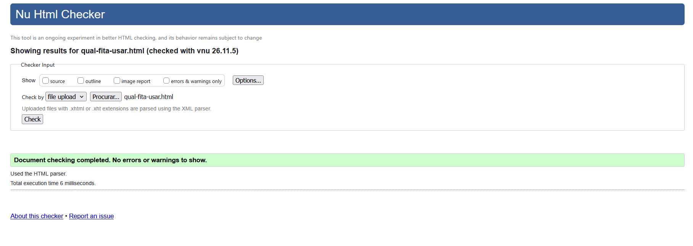
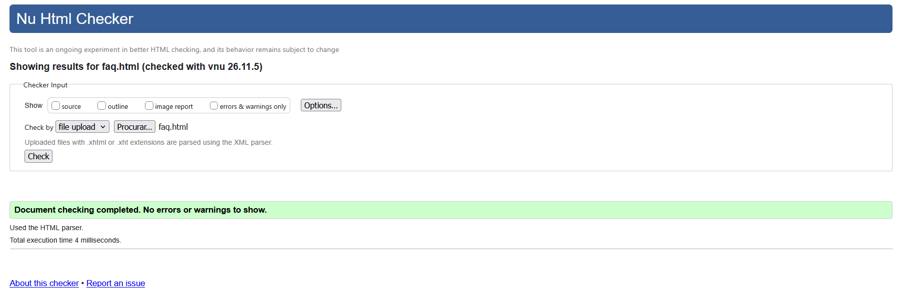
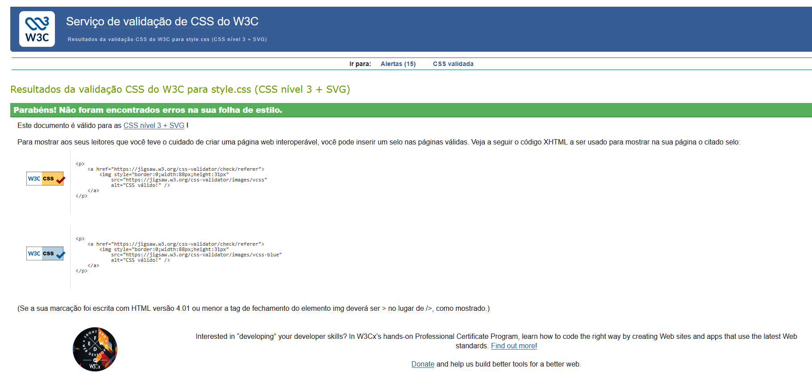

## Domínio

A FIT-PEL **já possui domínio próprio**, `fitpel.com.br` (o mesmo usado no e-mail institucional `sac@fitpel.com.br`), portanto o grupo não precisou comprar um. O site hospedado ainda usa o endereço do GitHub Pages; para usar o domínio próprio seria preciso apontar o DNS, o que depende de quem administra o domínio na empresa. Consulta feita no Registro.br em 06/11/2026: o domínio aparece como **"não disponível para registro — Domínio já registrado"**.

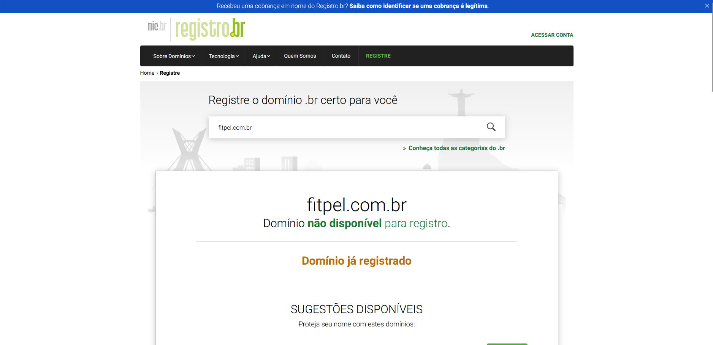

**Se a empresa não tivesse domínio**, o processo seria:

1. **Escolha do nome:** `fitpel.com.br`, curto, igual ao nome da marca e com a terminação `.com.br`, a mais reconhecida por empresas brasileiras.
2. **Pesquisa de disponibilidade:** consultar o nome em https://registro.br (campo de busca na página inicial) e registrar o resultado com print; também conferir se não há marca ou nome semelhante já em uso.
3. **Registro:** criar o cadastro no Registro.br com o CNPJ da empresa (72.704.299/0001-76) e solicitar o registro do domínio, com pagamento anual conforme a tabela de preços do próprio Registro.br.
4. **Apontamento para a hospedagem:** nas configurações de DNS, criar os registros indicados pelo GitHub Pages (ou pelo Netlify) e informar o domínio no campo "Custom domain" do repositório, ativando o HTTPS.
5. **E-mail:** manter ou configurar as caixas de e-mail do domínio, como `sac@fitpel.com.br`.

## Conclusão

Ao longo das duas entregas, o site da FIT-PEL saiu de uma estrutura em HTML puro (Entrega 1) para um site com identidade visual própria, responsivo e interativo (Entrega 2). A maior mudança foi perceber como o CSS dá identidade à marca: a mesma estrutura semântica passou a ter cores, tipografia e componentes (botões, cards, tabelas, formulários) que se repetem nas 10 páginas, com o vermelho do logotipo como fio condutor e o kraft e o grafite remetendo a embalagem e indústria.

As partes mais trabalhosas foram o Grid e o Flexbox combinados com o leiaute responsivo (por exemplo, o menu de 10 itens que quebrava em duas linhas ao trocar a fonte para Oswald e Inter) e os caminhos relativos no GitHub Pages, que funcionavam no computador e quebravam na hospedagem. Aprendemos também a tratar o JavaScript como melhoria progressiva: validação nativa do HTML5 continua funcionando sem JavaScript, e o script apenas acrescenta máscara de telefone, mensagens em português, busca instantânea, menu responsivo e FAQ expansível.

Sobre o uso de IA, ela acelerou a escrita do CSS e do JavaScript, mas não substitui a visita à empresa, o levantamento do conteúdo real, a escolha da paleta e das fontes, o teste no navegador e a validação no W3C Validator e no CSS Validation Service, que continuam sendo responsabilidade do grupo. Entender o código entregue foi necessário para corrigir problemas e justificar as decisões.

Como próximos passos, o grupo pretende otimizar imagens e vídeos para carregar mais rápido e, se a empresa quiser, apontar o domínio `fitpel.com.br` para a hospedagem do site.

## Como visualizar

Abra o arquivo `index.html` em um navegador, ou acesse o link do site hospedado  acima.
